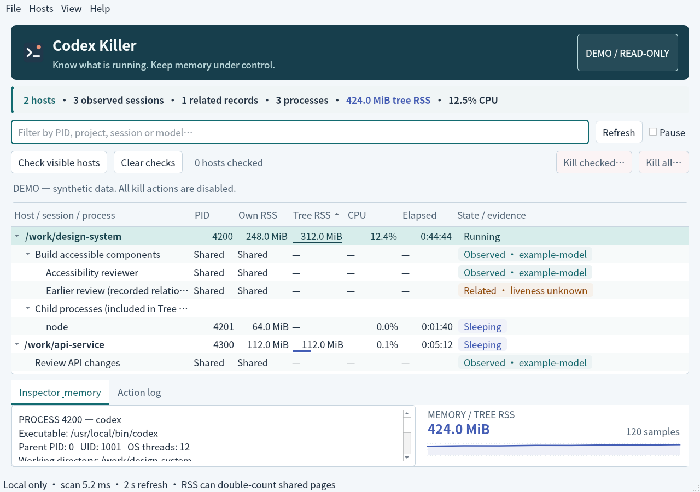

# Codex Killer

**Know what is running. Keep memory under control.**

A lightweight, native Linux desktop utility for inspecting running Codex hosts, their logical sessions and subagents, and their memory usage. Stop checked hosts or all discovered hosts with a confirmation step and graceful-to-forced shutdown.

No Electron. No web server. No daemon. No telemetry.



[Dark appearance preview](docs/demo-dark.png) · [Color and interaction notes](docs/appearance.md)

> **Safety boundary:** several Codex sessions or subagents can share one OS process. Their memory cannot be reliably attributed individually, and they cannot be independently killed with OS signals. Codex Killer shows that shared relationship instead of inventing per-session memory figures or promising isolated termination.

## Features

- Native C++17 / Qt Widgets window, system fonts and window controls, with semantic colors that follow the system's light/dark appearance.
- Discover Codex processes owned by your current user, including standard npm launchers and native app-server hosts.
- Expand host → logical session / subagent relationships and host → child-process trees.
- Own RSS, process-tree RSS, relative memory bars, and a bounded 120-sample total-memory history.
- CPU usage, elapsed time, OS thread count, executable identity, parent PID, and working directory.
- On-demand memory details: PSS, USS, private/shared pages, anonymous/file-backed RSS, swap, and peak RSS, subject to `/proc` permissions.
- Session metadata when reliably associated: ID, parent, title, model, provider, reasoning effort, role/nickname, Git branch, Codex version, source, and recorded token usage.
- Checked-host and all-host termination: confirmation → `SIGTERM` → 3-second grace period → `SIGKILL` for remaining confirmed processes.
- PID/start-time/UID/executable checks and Linux pidfds to avoid signalling a reused PID.
- Search, sortable numeric columns, resizable columns, keyboard actions, and pause sampling.
- A headless, read-only JSON snapshot command and a safe synthetic demo mode.

## Requirements

- Linux with `/proc`; Linux 5.3+ for pidfd-based termination. A sandbox or security policy can still deny pidfd operations, which are reported rather than bypassed.
- Qt **5.12+**, including Widgets, Sql, the SQLite driver, and Concurrent support.
- CMake 3.16+ and a C++17 compiler. Qt Test is required only when building tests.
- A graphical X11 or Wayland session for the window; `--snapshot` does not require one.

Ubuntu / Debian build dependencies:

```sh
sudo apt install build-essential cmake qtbase5-dev libqt5sql5-sqlite
```

These are installation instructions, not commands the application runs. **Do not run Codex Killer with sudo.**

## Build and run

```sh
git clone https://github.com/M1racleShih/codex-killer.git
cd codex-killer
cmake -S . -B build -DCMAKE_BUILD_TYPE=Release
cmake --build build -j2
ctest --test-dir build --output-on-failure
./build/codex-killer
```

Optional user-local installation, including the application-menu entry:

```sh
cmake --install build --prefix "$HOME/.local"
# Ensure ~/.local/bin is in PATH, then open “Codex Killer” from your app menu.
```

For a production build without test dependencies or fixtures, add `-DBUILD_TESTING=OFF` when configuring. The binary uses shared system Qt libraries; it is not a standalone static package.

### Other modes

```sh
./build/codex-killer --demo                  # Synthetic data; all kill actions disabled
./build/codex-killer --demo --demo-appearance dark  # Reproducible dark preview only
./build/codex-killer --snapshot              # One read-only JSON sample; no window
./build/codex-killer --codex-home /path/to/.codex
```

`CODEX_HOME` defaults to `~/.codex`. A discovered host's own `CODEX_HOME` takes precedence for that host. Process environment data is used only for the `CODEX_HOME` and `CODEX_THREAD_ID` keys; environment contents are never displayed or logged.

The JSON snapshot contains local working-directory paths. Review it before sharing it.

## Using the window

1. Start Codex normally. Hosts appear automatically, normally within two seconds.
2. Expand a host to see associated logical sessions and child processes.
3. Select a row to inspect it. **Highlighting a row does not choose a kill target.**
4. Check the checkbox on each **host** you want to stop, or use **Check visible hosts**.
5. Choose **Kill checked…** or **Kill all…**, inspect the affected hosts/sessions/process counts in the confirmation, then confirm or cancel.

**Kill all includes hosts hidden by the filter.** Checked hosts remain checked even when a filter hides them. Both cases are explained in the confirmation. Hosts containing Codex Killer or one of its ancestors are protected and excluded.

All sessions sharing a selected host and its confirmed child processes (for example MCP servers, shells, or tools) are affected. Unsaved work may be lost. The confirmed process set never silently expands: processes spawned after confirmation, detached processes, or processes reparented out of the selected tree can remain. Refresh and inspect the result rather than assuming every associated task has disappeared.

### Keyboard controls

- **Ctrl+F**: focus the filter.
- **F5**: refresh, including while periodic sampling is paused.
- **Space** on a focused host checkbox: toggle its check state.
- **Delete**: request termination of checked hosts; confirmation is still required.
- **Escape** in the confirmation: cancel.
- **Ctrl+Q**: close. Closing is deferred while a confirmed termination is in progress.

## What the numbers mean

| Metric | Meaning | Caveat |
| --- | --- | --- |
| Own RSS | Resident physical pages for one OS process | Shared pages can appear in more than one process's RSS |
| Tree RSS | Sum of RSS for unique PIDs under one Codex host | Not unique physical memory; does not add logical sessions as extra processes |
| PSS | Shared pages divided proportionally among processes | An on-demand measurement for the inspected process, not a live whole-tree total |
| USS | Private clean + private dirty + private huge pages | Approximation based on the kernel's `smaps_rollup` fields |
| Virtual address space | Mapped address space | **Not** resident memory consumption |
| CPU | CPU-time delta between samples | 100% means one fully busy CPU core; first sample is zero |
| Recorded tokens | Value from Codex's thread database | May be stale; not a billing or live-token meter |

Detailed memory is fetched asynchronously for only the inspected process and cached for up to five seconds. Permission-denied or unavailable fields are labelled as such, not presented as zero.

## Discovery and limitations

- A host is identified by its executable and standard launcher shape, not by searching arbitrary command text for “codex”. Unusual renamed binaries/custom launchers may not be detected. This is a convenience classifier, not an adversarial authenticity check.
- Sessions are associated using open rollout file descriptors or an explicit process thread ID. No recursive session-archive scan is performed.
- **Observed** means a runtime association was found, not that a model turn is currently working. Open rollout files can belong to idle loaded sessions.
- Related database edges are labelled **liveness unknown**. An `open` database edge, a recent timestamp, or a historical `task_started` event does not prove that an agent is still running.
- No runtime association? The host and its memory remain visible, but its logical sessions may not be available. Shared app-server hosts are not connected to or controlled through an undocumented API.
- Database and rollout formats are private Codex implementation details and can change. Metadata is best effort; process discovery does not depend on a readable database.
- Only your current user's visible processes are included. Other users, remote hosts, and inaccessible PID namespaces are outside this release.
- This release does not implement independent in-process subagent cancellation, historical conversation browsing, context/prompt inspection, or cross-platform support.

## Resource use

Sampling runs every two seconds, slows to ten seconds while minimized, and can be paused. Session-file reads are bounded, memory history and the in-window action log are bounded, and there is no watcher daemon or persistent monitoring database. Closing the window stops monitoring entirely.

Short, warmed-up measurements after the color refresh, on Ubuntu 24.04 / Qt 5.15.13: four synthetic hosts plus two other existing Codex hosts (six observed hosts total), sampled read-only. These eight-second samples are not a controlled before/after comparison.

| Mode | Monitor RSS | Monitor PSS | CPU, one core |
| --- | --- | --- | --- |
| Normal X11/KDE desktop window | ~136 MiB | ~33 MiB | ~1.1% |
| Qt offscreen test backend | ~59 MiB | ~19 MiB | ~1.1% |

RSS includes shared toolkit and desktop-integration pages. These are observed sample figures, **not a resource cap**; themes, display backends, process count, and metadata size affect overhead.

See [validation and performance notes](docs/validation.md) and the [reproducible benchmark](tools/benchmark.py).

## Development

```sh
cmake -S . -B build -DCMAKE_BUILD_TYPE=Release
cmake --build build -j2
ctest --test-dir build --output-on-failure

# Disposable synthetic fixtures only; never kills existing Codex processes.
python3 tools/benchmark.py --hosts 4 --seconds 12

# Safe documentation screenshot; real session data is not captured.
QT_QPA_PLATFORM=offscreen ./build/codex-killer --demo \
  --demo-screenshot /tmp/codex-killer-demo.png --quit-after-ms 1000
```

Read [design and safety](docs/design.md), [appearance](docs/appearance.md), [validation](docs/validation.md), and [contributor instructions](AGENTS.md) before changing discovery or termination.

## Privacy and security

Everything stays on your machine. The program has no network listener, telemetry, account integration, or model calls. It opens Codex state databases read-only and does not modify Codex settings. It does not open `auth.json`, and it does not display, retain, or transmit prompt/tool bodies. Session titles can themselves contain sensitive content: the inspector and confirmation are local UI, not safe-to-share reports by default.

Action results stay in a bounded, in-memory log, not a file. The only screenshot mode requires synthetic demo data. Do not publish real snapshots, environment dumps, session files, or local action logs.

## License

MIT. Qt remains separately licensed; this application dynamically links to the system's Qt installation. Codex Killer is an independent utility, not an official OpenAI product.
