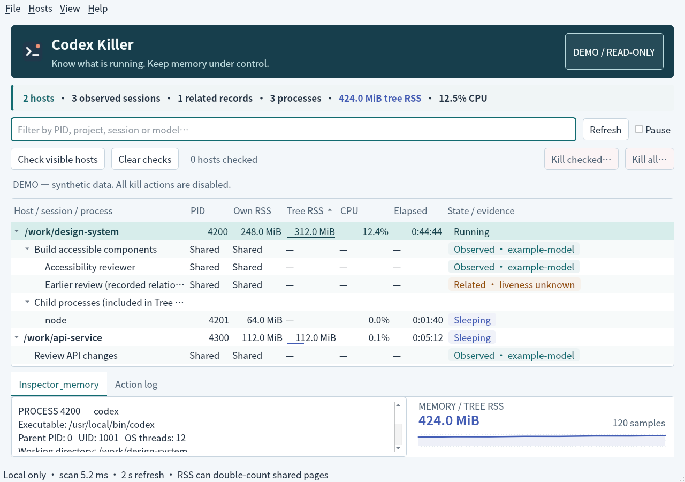
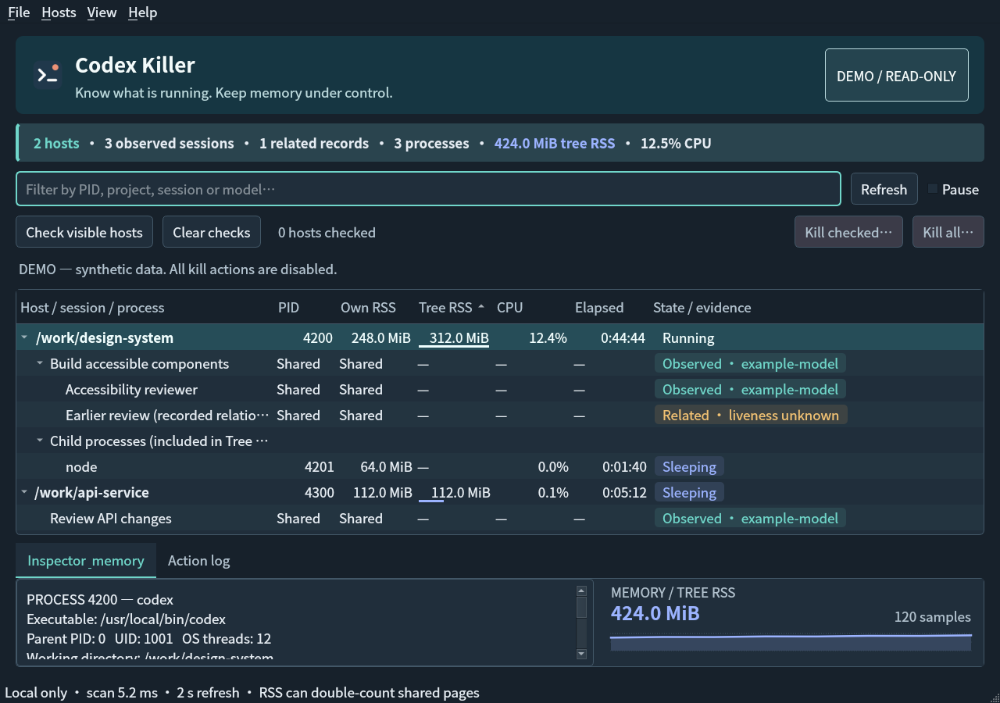

# Appearance

The screen's job is to make Codex resource usage and termination scope easy to scan. Its visual signature is a blue-green monitor header and a blue memory trace, not a wall of identically weighted gray controls.

## Color roles

The window follows the Qt application palette's light/dark appearance, including changes received while the window is open. It does not change the desktop theme or introduce a separate normal-use appearance setting. A custom desktop's exact accent colors are not copied: the app uses a small, consistent semantic palette instead.

| Role | Light | Dark | Contrast against content surface, light / dark |
| --- | --- | --- | --- |
| Content surface | `#ffffff` | `#202e3b` | — |
| Primary text | `#243547` | `#e5edf4` | 12.54 / 11.71 |
| Secondary text | `#536779` | `#b2c3d0` | 5.86 / 7.66 |
| Observed/running evidence and focus | `#126b70` | `#70d6ca` | 6.24 / 8.02 |
| Memory and sleeping processes | `#435db5` | `#9bb3ff` | 6.05 / 6.79 |
| Unknown liveness / caution | `#945008` | `#f0c274` | 6.16 / 8.36 |
| Destructive action text | `#b43b48` | `#ff9ba8` | 5.74 / 6.93 |

These are WCAG relative-luminance contrast ratios, not screenshot estimates. Tests also cover actual badge fills, the summary-strip memory text, selection text, header text, search-placeholder palette, and white text on filled destructive buttons. Informational state is always present as text; color is not the only signal. This is not a complete accessibility or high-contrast-theme certification.

## Layout and interaction

- A single brand header provides identity. A single summary strip emphasizes hosts and memory without adding a dashboard of redundant cards.
- Standard menu, search, checkbox, tree, tabs, and button widgets retain their keyboard behavior. Columns remain sortable/resizable and the inspector remains selectable plain text.
- Memory bars and the bounded area trace use the same blue role. They still describe RSS, not additional per-session memory.
- State badges distinguish observed associations, sleeping processes, and related-only records. “Observed” does **not** mean a turn is actively working; unknown liveness is not styled as verified activity.
- Enabled kill actions and the confirmation's destructive button use red. Disabled actions are subdued and remain non-interactive. Cancel remains the default confirmation action.
- Focus, hover, pressed, selected, and disabled states are explicit. The 780×600 minimum window is covered by a layout test; dense content can scroll.
- The user can drag the splitter to trade table space for inspector/chart space. There is no animation, blur, shadow effect, downloaded font, or new rendering dependency.

## Synthetic previews

Both screenshots contain invented session data. All kill actions remain disabled.

### Light



### Dark



For reproducible previews only:

```sh
QT_QPA_PLATFORM=offscreen ./build/codex-killer --demo --demo-appearance light \
  --demo-screenshot /tmp/codex-killer-light.png --quit-after-ms 1000
QT_QPA_PLATFORM=offscreen ./build/codex-killer --demo --demo-appearance dark \
  --demo-screenshot /tmp/codex-killer-dark.png --quit-after-ms 1000
```

`--demo-appearance` requires `--demo`; it cannot override the appearance of a real monitoring session. The normal window follows the system-provided Qt palette.

## Implementation scope

Colors are centralized in `src/appearance.h`; the window uses a small stylesheet and lightweight delegates for state badges and memory bars. The trace is painted with `QPainter` using the existing 120-sample history. No sampling, process discovery, session-evidence, or pidfd termination contract was changed by the visual refresh.
