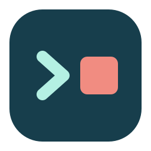

# Logo and desktop integration

## The mark



A **mint terminal prompt** points toward a **coral stop square** on a deep blue-green tile. The idea is deliberately simple: inspect a command session, then decide when to stop it. The large filled square remains distinct at desktop-icon sizes; there is no tiny text, weapon imagery, or OpenAI branding.

- Tile: `#173e4c`, matching the window's blue-green brand area.
- Prompt: `#b4f0e3`.
- Stop square: `#f18c81`, echoing destructive actions without making the whole icon red.
- Transparent outer margin; flat vector shapes, no shadows, blur, external images, or fonts.

### Assets

- Source: [packaging/codex-killer.svg](../packaging/codex-killer.svg).
- PNGs: `packaging/icons/{16,24,32,48,64,128,256,512}/codex-killer.png`.
- Embedded application resources: [packaging/icons.qrc](../packaging/icons.qrc).
- Application and header integration: `src/branding.h`.

The application embeds 16–256 px PNGs, so its window/taskbar/header icon works from any working directory, without QtSvg or a desktop icon-theme lookup. CMake installs both scalable SVG and 16–512 px PNGs into the user's icon hierarchy. The SVG is the source of truth; regenerate PNGs after changing it:

```sh
# Development only; not needed for normal builds or running the application.
sudo apt install librsvg2-bin
python3 tools/render-icons.py
cmake --build build -j2
```

## Current-user installation

Build first, then run:

```sh
python3 tools/install-desktop.py --build-dir build --desktop
```

Default outputs:

| Item | Location |
| --- | --- |
| Installed executable | `~/.local/bin/codex-killer` |
| Application-menu entry | `~/.local/share/applications/io.github.M1racleShih.CodexKiller.desktop` |
| Desktop shortcut | The configured desktop directory + `Codex Killer.desktop` |
| Scalable icon | `~/.local/share/icons/hicolor/scalable/apps/codex-killer.svg` |
| Raster icons | `~/.local/share/icons/hicolor/<size>x<size>/apps/codex-killer.png` |

The generated entries use **absolute** `Exec`, `TryExec`, and `Icon` paths, not a shell command or a relative build path. `Terminal=false` prevents an extra terminal window. The app's desktop ID and X11 window class match the application entry, helping the desktop group its windows under the correct icon.

The script does not launch the program, install a service, enable autostart, request elevated privileges, or modify Codex settings. It gives the desktop shortcut executable permissions and attempts GIO trust metadata where supported. KDE can use the executable shortcut even when GNOME-specific trust metadata is unavailable. A file manager can still ask for one-time launch confirmation under its own policy.

Existing shortcut/application files must carry `X-Codex-Killer-Managed=true`; otherwise the installer refuses to replace them. Symbolic-link launchers are also refused. Files for other applications, including similarly named Codex desktop applications, are not touched. Desktop Entry path escaping is tested, including spaces and reserved characters.

Custom staging example:

```sh
python3 tools/install-desktop.py --build-dir build \
  --prefix /tmp/codex-killer-check --desktop --desktop-dir /tmp/codex-killer-desktop
```

CMake's ordinary `cmake --install build --prefix ...` remains available, but its portable packaged entry uses `Exec=codex-killer` and relies on the desktop session's `PATH`. The Python installer rewrites that entry to make desktop launching independent of `PATH`.

Rebuilding the repository does not silently change the installed executable. Run the installer again after an update. No root or system-wide installation is needed.

## Validation

The UI test checks every embedded icon size, transparency, the stop-square color, and the window icon. Installer tests cover absolute-path launchers, reserved-character escaping, path-injection rejection, refusal of unrelated/symlink shortcuts, and executable atomic writes. CI additionally stages an installation into a prefix containing a space, validates the desktop entry, and runs the installed binary in synthetic demo mode.

Only synthetic previews may be published. Do not capture real session details or other desktop windows to document the logo.
